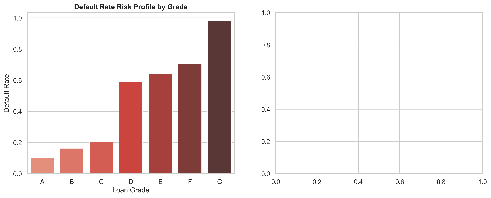

# Credit Risk & Loan Default Analysis Pipeline

An end-to-end machine learning and financial risk optimization pipeline built in Python. This project evaluates borrower creditworthiness, benchmarks classification algorithms, and optimizes credit approval decision boundaries using a custom financial loss matrix.

---

## 📌 Executive Summary
- **The Problem:** Financial institutions incur significant losses from loan defaults (~$9,500 average principal loss per default), while overly conservative approval criteria reject solvent borrowers (~$1,100 average lost interest revenue).
- **The Solution:** Processed 32,581 borrower records from `archive (1)/credit_risk_dataset.csv`, engineered financial burden ratios, trained benchmark classification algorithms, and optimized decision thresholds to minimize monetary losses.
- **Key Business Impact:** XGBoost achieved an **ROC-AUC of 0.9489**. Tuning the approval decision threshold from **0.50 down to 0.20** reduced projected institutional financial losses from **$3.04M to $2.36M**, yielding a net loss reduction of **$679,033.87 (~22.3%)**.

---

## 🛠️ Tech Stack & Methods
- **Language & Environment:** Python 3.11, VS Code, Jupyter Notebook
- **Libraries:** Pandas, NumPy, Scikit-Learn, XGBoost, Matplotlib, Seaborn
- **Data & Feature Engineering:** Imputed missing values (employment length, interest rates), handled age/income outliers, and created engineered financial ratios (`debt_to_income`, `interest_to_income`, `credit_hist_ratio`).
- **Class Imbalance:** Applied cost-sensitive learning (`scale_pos_weight`) to optimize default detection for minority class samples.

---

## 📊 Model Performance Benchmarking

| Model | ROC-AUC | Recall (Default Detection) | Precision |
| :--- | :---: | :---: | :---: |
| Logistic Regression | 0.8780 | 0.7968 | 0.5442 |
| Random Forest | 0.9290 | 0.7511 | 0.8834 |
| **XGBoost (Selected)** | **0.9489** | **0.7947** | **0.8352** |

---

## 📈 Financial Threshold & Risk Analysis



### Key Business Insights
- **Default Risk by Grade:** Default rates scale sharply across loan grades—ranging from **~9.96% in Grade A** up to **98.44% in Grade G**.
- **Institutional Cost Optimization:**
  - **Standard Threshold (0.50):** $3,041,509.09 expected loss
  - **Optimal Threshold (0.20):** $2,362,475.22 expected loss
  - **Total Projected Net Savings:** **$679,033.87**

---

## 🚀 Setup & Execution

1. **Clone the repository:**
   ```bash
   git clone [https://github.com/tiyasa4448/credit-risk-assessment.git](https://github.com/tiyasa4448/credit-risk-assessment.git)
   cd credit-risk-assessment